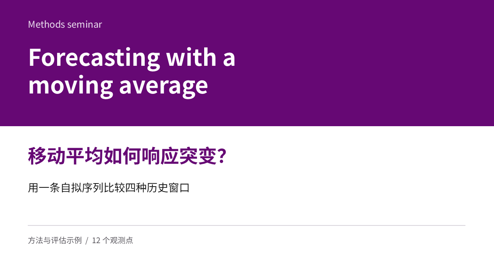

# 清华紫学术 PPT · Codex Skill

用 Codex 把论文、组会材料或技术报告做成可编辑的学术演示。16∶9 白底，页首使用 `#660874` 紫色顶栏，左侧放标题，右上可放机构标志。



## 获取与安装

- **安装到 Codex**　将下面这句话发给 Codex，使用内置的 `$skill-installer` 安装固定版本。
- **离线安装**　在发布页下载 `artifact-template-thu-ppt-v1.0.0.zip`，解压后将整个 `artifact-template-thu-ppt` 文件夹放入 `$CODEX_HOME/skills/`。默认安装目录为 `~/.codex/skills/`。在下一条消息中即可调用。[下载 v1.0.0 和 SHA-256 校验文件](https://github.com/ZewenCheng/artifact-template-thu-ppt/releases/tag/v1.0.0)
- **直接使用 PowerPoint**　下载可编辑母版，复制所需页型，再替换内容和图表数据。[下载 PPTX](https://raw.githubusercontent.com/ZewenCheng/artifact-template-thu-ppt/v1.0.0/skills/artifact-template-thu-ppt/assets/reference.pptx)

```text
$skill-installer 请从 https://github.com/ZewenCheng/artifact-template-thu-ppt/tree/v1.0.0/skills/artifact-template-thu-ppt 安装这个技能。
```

安装后，附上论文或草稿即可调用。

```text
用 $artifact-template-thu-ppt 把这篇论文做成 12 页组会 PPT。重点解释方法和消融实验，每页写中文讲稿。
```

## 母版包含什么

20 种页型覆盖研究问题、方法图、公式、结果、消融和讨论。PPTX 内有 11 张原生表格、4 幅带工作簿的图表、3 个 Office 数学对象，以及逐页中文演讲者备注。右上角为可替换的标志位。[版式索引](skills/artifact-template-thu-ppt/references/layout-catalog.md) · [第 1 至 10 页](skills/artifact-template-thu-ppt/assets/reference-contact-sheet-01-10.jpg) · [第 11 至 20 页](skills/artifact-template-thu-ppt/assets/reference-contact-sheet-11-20.jpg)

教学示例比较不同移动平均窗口在一条自拟序列上的单步预测误差。数据和复算脚本随技能分发。可在仓库根目录运行以下命令，查看各时点预测值、绝对误差和分组指标。脚本只使用 Python 3 标准库。[CSV 数据](skills/artifact-template-thu-ppt/assets/example-series.csv) · [计算脚本](skills/artifact-template-thu-ppt/scripts/example_windows.py) · [公式源](skills/artifact-template-thu-ppt/assets/formulas.tex)

```sh
python skills/artifact-template-thu-ppt/scripts/example_windows.py
```

## 许可与素材来源

仓库内的技能说明、脚本、教学数据、可编辑母版和由它生成的预览，以 MIT 许可证发布。允许商用、修改和再分发。分发副本或实质性部分时，请保留版权声明及许可声明。[MIT 许可证](LICENSE)

本项目独立制作。“清华紫”是配色名称。色值参考自 Atomie CHEN 的 THU-PPT-Theme，该项目采用 CC BY-NC-SA 4.0。公开母版从空白画布绘制，使用通用几何元素与自拟教学内容。历史课件、第三方论文图和学校标志均未随包发布。使用时可放入有相应授权的标志和研究素材。[配色参考项目](https://github.com/atomiechen/THU-PPT-Theme#license) · [本发行版素材记录](skills/artifact-template-thu-ppt/references/provenance.json)
